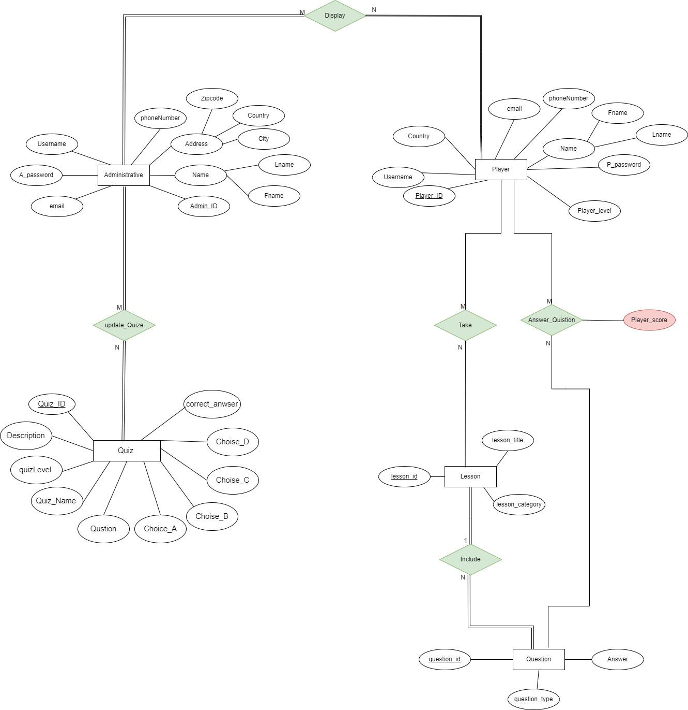
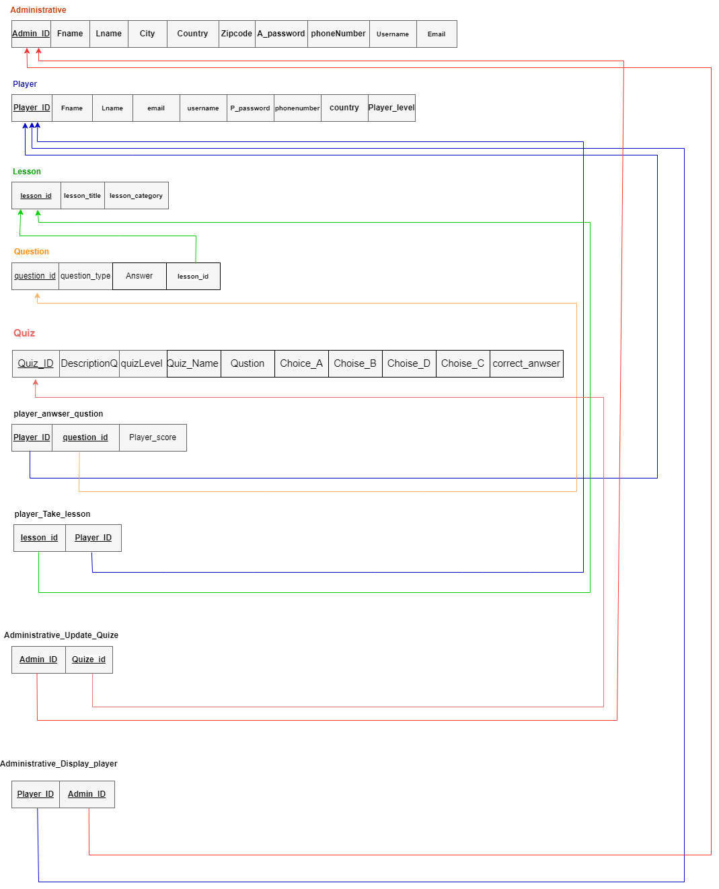

# 👣 Digital Steps

A console game that teaches **Java and Object-Oriented Programming** step by step, from your very first variable to inheritance and polymorphism. Learn a topic, take a quiz, earn points and compete on the score table.

> Team project for the Computer Science department, Imam Abdulrahman Bin Faisal University (IAU).

---

## 🎯 Objectives

- **Easy start for beginners:** step-by-step lessons and exercises that help new programmers get past the first hurdles.
- **Skill building for intermediate learners:** loops, arrays, methods and problem solving.
- **Advanced OOP:** classes, objects, relationships, inheritance, polymorphism and more.

**Who it's for:** CS students, self-learners who like a gamified approach, programmers moving to Java, and anyone curious about Java OOP.

## 🎮 Features

- **Two roles:** play as a **Player** to learn and take quizzes, or log in as an **Admin** to manage content.
- **Three levels:** Beginner → Intermediate → Advanced, each with lessons and a quiz.
- **Quizzes and scoring:** multiple-choice questions with instant feedback, plus an OOP competition quiz.
- **Score table:** compete with other players and see the rankings.
- **Learning extras:** reading material on program design, types of programming languages and common error types.
- **Feedback:** players can leave comments at the end.
- **Colored console UI** using ANSI colors.

## 🗄️ Database design

In a follow-up **Database Concepts & Design (CIS 321)** course, we designed a **MySQL** database for Digital Steps. It stores players, admins, lessons, quiz questions and scores, and supports account creation, level tracking and the global competition.

<p align="center">
  
  
</p>

- **Entities:** `Administrative`, `Player`, `lesson`, `Question`, `Quiz`
- **Relationships (M:N):** admin *displays* player, admin *updates* quiz, player *takes* lesson, player *answers* question (with a score)
- **SQL features:** primary/foreign keys, `UNIQUE` and `NOT NULL` constraints, nested queries (including relational division), `GROUP BY` and aggregates, views, stored procedures, a function (average score per player) and a trigger that rejects invalid scores

| File | What it contains |
|---|---|
| [`database/schema.sql`](database/schema.sql) | Creates the database and all tables |
| [`database/sample_data.sql`](database/sample_data.sql) | Demo data (all names, emails and phone numbers are fictional) |
| [`database/queries.sql`](database/queries.sql) | Queries, views, procedures, function and trigger |

```bash
mysql -u root -p < database/schema.sql
mysql -u root -p < database/sample_data.sql
mysql -u root -p < database/queries.sql
```

## 📁 Project structure

```
.
├── src/digitalsteps/
│   ├── DigitalSteps.java        # Main entry point (menus, roles, flow)
│   ├── User.java / Player.java / Admin.java
│   ├── Quiz.java                # Base quiz logic + learning material
│   ├── Beginner.java / BeginnerQuiz.java
│   ├── Intermediate.java / IntermediateQuiz.java
│   ├── Advance.java             # Advanced OOP lessons
│   ├── CreatePrivateClass.java  # Quiz system classes
│   ├── Scoretable.java          # Competition & score table
│   └── DesingText.java          # Console colors
├── resources/                   # Text files the game reads and writes
│   ├── textfilemcq.txt          # OOP competition questions
│   ├── Disign.txt / PRlevel.txt / ErrorType.txt   # Learning material
│   ├── data.txt                 # Score table data
│   └── score.txt                # Player comments
├── database/                    # MySQL schema, sample data and queries
└── docs/images/                 # ER diagram and relational mapping
```

## ▶️ How to run

Requires Java (JDK 8 or newer). Run these from the project root so the game can find the `resources/` folder:

```bash
javac -encoding UTF-8 -d out src/digitalsteps/*.java
java -cp out digitalsteps.DigitalSteps
```

You can also open the project in NetBeans or IntelliJ and run `DigitalSteps.java`. Just set the working directory to the project root.

---

<details>
<summary>🇸🇦 ملخص بالعربي</summary>

**Digital Steps** لعبة تعليمية تشتغل في الـ Console، وتعلّم لغة Java والبرمجة الكائنية (OOP) خطوة بخطوة، على ثلاث مستويات: مبتدئ، ومتوسط، ومتقدم. كل مستوى فيه دروس واختبار. وفيها جدول نقاط للمنافسة بين اللاعبين، ودورين: لاعب ومشرف.
</details>
